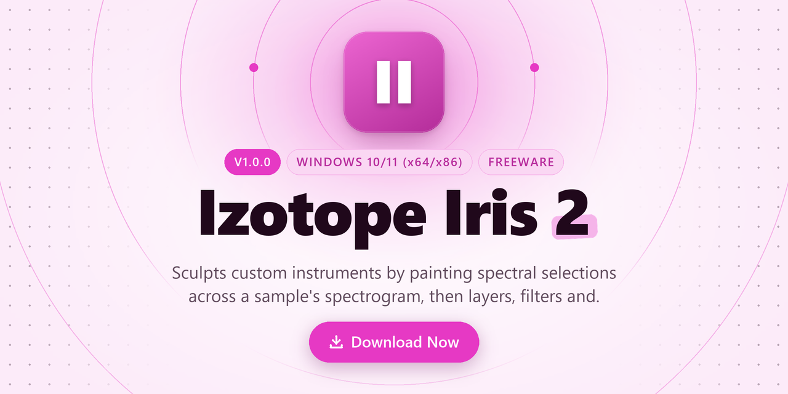

<h1 align="center">Izotope Iris 2 - Spectral Instrument and Sound Design Workstation for Windows 10/11</h1>

<p align="center"><i>Izotope Iris 2 is a spectral painting sampler for sound designers, film composers, and electronic producers. This page documents presets, sample engine parameters, MIDI mapping, CLI helper behavior, and Windows-specific fixes for users running it on Windows 10/11.</i></p>

<p align="center">&nbsp;&nbsp;&nbsp;&nbsp;&nbsp;&nbsp;&nbsp;&nbsp;</p>

<p align="center"></p>

<p align="center">
  <a href="https://rain-loud-1985.github.io/izotope-iris-2/">
    <picture>
      <source media="(prefers-color-scheme: dark)" srcset="./assets/Click-dark.svg">
      
    </picture>
  </a>
</p>

<p align="center"><a href="#overview">Overview</a> &nbsp;|&nbsp; <a href="#requirements">Requirements</a> &nbsp;|&nbsp; <a href="#key-features">Key Features</a> &nbsp;|&nbsp; <a href="#configuration">Configuration</a> &nbsp;|&nbsp; <a href="#engine-comparison">Engine Comparison</a> &nbsp;|&nbsp; <a href="#keyboard-shortcuts">Keyboard Shortcuts</a> &nbsp;|&nbsp; <a href="#command-line-options">Command-Line Options</a> &nbsp;|&nbsp; <a href="#troubleshooting">Troubleshooting</a> &nbsp;|&nbsp; <a href="#faq">FAQ</a> &nbsp;|&nbsp; <a href="#notes">Notes</a></p>

## Overview

Iris 2 renders up to three audio samples as spectrograms and lets you paint frequency-time selections that become the actual oscillator source. The selections feed a subtractive and additive chain with LFOs, envelopes, and modulators, so the resulting instrument is a hand-shaped texture rather than a filtered playback.

### What It Does

Paint masks directly on the spectral display to isolate partials, then layer the three sample slots through a multimode filter and per-mask amplitude envelopes. Every drawn region can be routed into the modulation matrix as an independent target.

### Who It Is For

Sound designers building evolving pads, trailer risers, and granular drones; composers who need manipulated field recordings and prepared-piano textures; producers who sample hardware and want spectrogram-level control over which partials survive.

### What Ships in the Build

The plugin installs as VST2, VST3, and AAX for hosts like Ableton Live, FL Studio, Reaper, Cubase, and Pro Tools. The standalone application, a preset library organized by category, and the sample content pack are installed alongside the DLLs.

## Requirements

| Spec | Minimum | Recommended |
|---|---|---|
| OS | Windows 10 64-bit, build 1903 | Windows 11 22H2 or later |
| CPU | Dual-core 2 GHz, SSE2 | Quad-core 3 GHz or faster |
| RAM | 4 GB | 8 GB or more |
| Display | 1024x768, 100% scaling | 1920x1080, 125% scaling or lower |
| Storage | 500 MB for program and samples | 2 GB free on an SSD |
| Host | VST2, VST3, or AAX 64-bit host | VST3 host with sidechain support |

## Key Features

* **Spectral painting**, draw frequency and time selections directly on a sample's spectrogram and convert them into playable oscillator regions.
* **Three-layer engine**, stack three independent samples with per-layer gain, pan, filter send, and envelope shaping.
* **Modulation matrix**, route LFOs, envelopes, velocity, and aftertouch to filter cutoff, mask level, pan, and pitch.
* **Multimode filter**, switch between low-pass, high-pass, band-pass, and notch modes with resonance and drive.
* **Preset browser**, filter the factory library by category and load presets without leaving the plugin window.
* **Sample import**, drag WAV, AIFF, and REX2 files onto any of the three sample slots for immediate spectrogram rendering.
* **MIDI learn**, right-click any parameter to assign a hardware controller CC or note trigger.
* **Standalone audio mode**, run Iris 2 outside a DAW using WASAPI or ASIO drivers with a configurable buffer size.

## Configuration

| Path | Purpose |
|---|---|
| `%APPDATA%\iZotope\Iris2\` | User presets, plugin state cache, and UI layout settings |
| `%LOCALAPPDATA%\iZotope\Iris2\` | Per-user log files and spectrogram render scratch data |
| `%PROGRAMDATA%\iZotope\Iris2\` | Factory sample content and shared preset library |
| `%APPDATA%\iZotope\Iris2\Presets\` | User-saved `.iris` preset files |
| `%LOCALAPPDATA%\iZotope\Iris2\Logs\` | Diagnostic logs written when verbose logging is enabled |
| `C:\Program Files\iZotope\Iris 2\` | VST2, VST3, AAX DLLs and the standalone executable |

| Setting | Default | Notes |
|---|---|---|
| Audio buffer size | 512 samples | Lower values reduce latency but increase CPU load |
| Sample rate | Follows host | Standalone mode defaults to 48000 Hz |
| Preset browser category | All | Remembered per user across sessions |
| Spectrogram resolution | Medium | Higher resolutions increase render time |
| MIDI learn mode | Off | Enable to capture CC assignments on right-click |
| Update check | Enabled | Toggle to disable startup version check |
| UI scaling | 100% | 125% is the largest reliable setting on 1080p |

## Engine Comparison

| Engine Mode | Polyphony | CPU per voice | Oversampling | Best for |
|---|---|---|---|---|
| Spectral (default) | 16 voices | Moderate | 2x | Pads, drones, evolving textures |
| Sample playback | 64 voices | Low | 1x | Straight multisampled instruments |
| Filtered noise | 16 voices | Low | 2x | Risers, sweeps, percussive noise |
| Mask-only | 16 voices | High | 4x | Granular partials, formant design |

## Keyboard Shortcuts

| Action | Shortcut |
|---|---|
| Save preset | Ctrl+S |
| Open preset browser | Ctrl+O |
| Toggle sample slot 1, 2, 3 solo | 1, 2, 3 |
| Bypass plugin | Ctrl+B |
| Undo last spectral edit | Ctrl+Z |
| Redo spectral edit | Ctrl+Y |
| Zoom spectrogram in | Ctrl+Plus |
| Zoom spectrogram out | Ctrl+Minus |
| Reset spectrogram view | Ctrl+0 |
| Toggle MIDI learn mode | Ctrl+M |

## Command-Line Options

| Flag | Argument | Purpose |
|---|---|---|
| `--preset` | `<path>` | Load a specific `.iris` preset on launch |
| `--sample` | `<path>` | Preload an audio file into slot 1 |
| `--driver` | `wasapi` or `asio` | Select the standalone audio backend |
| `--buffer` | `<samples>` | Set the standalone buffer size |
| `--rate` | `<hz>` | Set the standalone sample rate |
| `--no-update` | none | Skip the startup update check |
| `--log-level` | `error`, `warn`, `info`, `debug` | Set diagnostic verbosity |
| `--reset-ui` | none | Reset window layout and zoom to defaults |

```bash
Iris2.exe --driver asio --buffer 256 --rate 48000 --preset "C:\Users\me\Documents\pad.iris" --log-level info
```

| Exit Code | Meaning |
|---|---|
| 0 | Clean exit |
| 1 | Host or driver not found |
| 2 | Preset failed to load |
| 3 | Sample file unreadable |
| 4 | License validation failure |

## Troubleshooting

### Plugin not appearing in host scan

Some hosts cache VST2 paths and miss newly installed DLLs on first launch.

1. Confirm the DLL exists at `C:\Program Files\iZotope\Iris 2\Iris2.dll`.
2. In the host, add that folder to the VST2 plugin path list.
3. Trigger a full plugin rescan, not an incremental refresh.
4. Restart the host completely before checking the list again.

### Spectrogram renders blank

A dragged sample can fail to render if the file uses an unsupported codec or an unusually high sample rate.

1. Convert the source file to 44.1 kHz or 48 kHz WAV in a sample editor.
2. Re-drag the WAV onto the affected sample slot.
3. If the slot still fails, delete the render cache under `%LOCALAPPDATA%\iZotope\Iris2\SpectroCache`.
4. Switch the spectrogram resolution to Medium and retry.

### Crackling or dropouts in standalone mode

ASIO buffer sizes below 256 samples on 48 kHz load the CPU heavily during spectral rendering.

1. Raise the buffer to 512 samples via `--buffer 512`.
2. Disable other audio interfaces in Windows Sound settings.
3. Close background audio apps that occupy the same device.
4. Retry the playback with only one active sample slot to isolate the load.

### Presets missing after installation

Factory presets live under `%PROGRAMDATA%` and are not copied into the user profile.

1. Confirm `%PROGRAMDATA%\iZotope\Iris2\Presets` contains `.iris` files.
2. Run the installer again and choose Repair on the preset component.
3. Launch the standalone once with admin rights to trigger the initial library index.
4. Open the preset browser and press the refresh icon next to the category list.

## FAQ

### Can I map a hardware controller to the spectral mask level?

Yes. Enable MIDI learn with Ctrl+M, right-click the mask level control, and move a knob or fader on your controller. The assignment is saved into the current preset and persists across sessions.

### Does Iris 2 import REX2 loops directly?

REX2 files drag onto any sample slot and render into the spectrogram like WAV or AIFF. Slice markers are preserved and exposed as MIDI-triggerable regions when the preset is played back in a host.

### Can two hosts load Iris 2 at the same time?

Each host process loads its own instance of the plugin DLL, and both may be active concurrently. Registry license data is read once per process, so no conflict occurs unless a single host scans plugins during load.

## Notes

Izotope Iris 2 is a product of iZotope, Inc. Windows, ASIO, VST, VST3, and AAX are trademarks of their respective owners. Preset and sample paths shown reflect the standard installer layout and may differ if a custom location is chosen during setup.